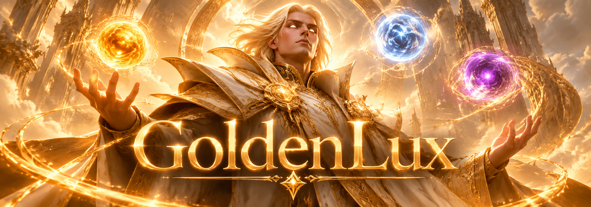

# GoldenLux

GoldenLux - это универсальная тема для любого сайта которая подойдет 
как для WordPress, так и для OpenCart, Laravel и любого другого 
бэкенд фреймворка, вплоть до Strapi/Directus/etc.

## Технологии
- `Quas` - полный аналог Tailwind CSS в одну строчку по CDN.
- `Wex` - улучшенный аналог Vue JS в одну строчку по CDN.
- `DaisyUI` - готовая компонентная библиотека на основе Tailwind.

## Архитектура
- `Components` - здесь хранятся маленькие части приложения
- `Layouts` - здесь хранятся большие, переиспользуемые части
- `Pages` - здесь хранятся все страницы сайта для роутера
- `Photos` - картинки и прочие визуальные ассеты темы
- `Structures` - JSON, откуда берутся данные, легко заменить на API
- `Styles` - кастомная стилизация нужных частей темы
- `Index.html` - единая точка входа в приложение